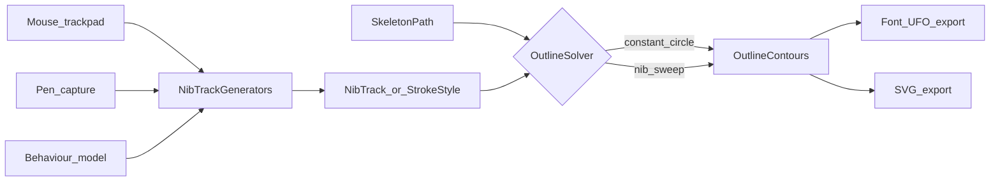

# Strokes, nib and pen input — living roadmap

**Branch:** `explore/strokes` only. Isolated from [UI sound](../README.md#tracks); do not link from [ROADMAP.md](../../ROADMAP.md) until Kostya aligns.

**Last revised:** 2026-11-22

## Related documents

| Doc                                | Purpose                                    |
| ---------------------------------- | ------------------------------------------ |
| [SPEC-map.md](./SPEC-map.md)       | Module map and build order                 |
| [CONSTRAINTS.md](./CONSTRAINTS.md) | Quality bar for stroke work on this branch |

## How to use this document

- This is the shared vision for strokes, nibs, and pen input. It is **not** canonical repo architecture; see [docs routing](../../docs/architecture/index.md).
- Work in **streams** (Foundation, A, B, C, D). Each task has a status, size guess, and **Learn** field: what we expect to discover.
- Stop at **checkpoints** to answer the review questions, update the **decision log**, and pivot or continue.
- When `main` ships unrelated contour work (e.g. remove overlap, offset path on the product roadmap), refresh dependencies in §Margins and re-check CP3.
- **Alignment (revised 2026-11-20):** build and play with the feature **locally first**, including essential (unpolished) UI, because a described feature is open to many interpretations. Once it fits the product, message Kostya on Discord, open the umbrella GitHub issue on `shift-editor/shift`, and start socialising. Module-level plan: [SPEC-map.md](./SPEC-map.md).

### Task status key

| Status    | Meaning                                      |
| --------- | -------------------------------------------- |
| `—`       | Not started                                  |
| `spike`   | Time-boxed experiment                        |
| `wip`     | In progress                                  |
| `done`    | Exit criteria met on this branch or upstream |
| `pivot`   | Stopped or redirected; see decision log      |
| `blocked` | Waiting on dependency or alignment           |

### Size key

`S` (< few days), `M` (about a week), `L` (multi-week), `XL` (epic; split at checkpoint).

---

## Vision

Shift should support **editable skeleton paths** whose **outlines are derived**: icon-style constant strokes first, then calligraphic nibs and stroke styles, with **mouse and pen interoperable** on the same nib track. Glyphs remain the default artifact; **SVG export is unconditional** for every glyph, with optional icon niceties on top.

**Reference product space:** LTTR/INK (skeleton type design, per-point nib, stroke styles, clean vectorisation), Figma-like stroke caps/joins/width on paths, Fontographer-style craft for type.

**Not in vision v1:** live collaboration on strokes, AI-generated nibs, a separate “icon app” mode, or shipping Fontographer sound/haptics here (see `explorations/ui-sound` when that branch is present).

### One pipeline

- **Skeleton:** ordinary contour geometry (points, segments, open/closed).
- **Nib track / stroke style:** caps, joins, width, miter; later width/height/angle per point and named styles.
- **Solvers:** exact offset for circular nib (kurbo `stroke` / `offset`); sampled sweep + union + refit for general nibs ([linesweeper](https://crates.io/crates/linesweeper) already used for booleans).
- **Generators (stream C):** all produce the same nib-track data; users can switch input method mid-glyph.

### Non-goals (for now)

- Replacing the Pen tool’s point-by-point model entirely.
- iOS-native pen capture inside Shift Desktop (Sidecar is in scope only via Electron pointer events).
- Competing with full parametric stroke interpolation (LTTR/INK “Master” tier) before B4/B5 prove the data model.

---

## Engineering invariants (from Shift)

- **Rust owns the solver and export semantics** ([shift-font](../../crates/shift-font/docs/DOCS.md), [shift-wasm route](../../crates/shift-wasm/docs/DOCS.md)): no second TypeScript implementation of outline generation; call WASM for editor-sync rules.
- **Types** live in `@shift/types` / domain patterns; no ad-hoc stroke structs in app files.
- **Tests:** behavior via `TestEditor` and Rust tests on fixtures; reference skeletons in `fixtures/` or `crates/shift-font/tests/`.
- **UFO round-trip:** prefer `com.shift.*` lib keys when the model is not representable in standard UFO contours alone (pattern used for grid: `com.shift.grid`).
- **Existing anchors:** kurbo 0.13 (`stroke`, `offset`, `simplify_bezpath`, `fit_to_bezpath`), [curve_fit.rs](../../crates/shift-font/src/curve_fit.rs), SVG **import** ([svg_path.rs](../../crates/shift-font/src/svg_path.rs)), boolean ops in [ir/boolean.rs](../../crates/shift-font/src/ir/boolean.rs).

### Relation to product [ROADMAP.md](../../ROADMAP.md)

| Product item                 | This exploration                              |
| ---------------------------- | --------------------------------------------- |
| Offset path (Phase 3.5)      | Stream A1; may upstream as product PR         |
| Remove overlap               | Dependency for A2/B6 mixing strokes and fills |
| SVG import                   | D1 is symmetric export                        |
| 0.5.0 Drawing Workflow Depth | A1–A3 are candidates once CP1 passes          |

---

## Stream F — Foundation (P0)

**Goal:** Agree how strokes live in the font model, where solvers live, and how we judge outline quality—before UI diverges.

| ID   | Task                                                                                                                                                                                  | Status | Size | Learn                                                | Exit criteria                                                                                                                                               |
| ---- | ------------------------------------------------------------------------------------------------------------------------------------------------------------------------------------- | ------ | ---- | ---------------------------------------------------- | ----------------------------------------------------------------------------------------------------------------------------------------------------------- |
| F0.1 | **Data model spike:** compare (a) stroke metadata on `Contour`, (b) parallel “skeleton” layer objects, (c) lib-only storage with generated outlines on export                         | `done` | M    | UFO/persistence cost per option                      | [F0.1](./F0.1-data-model-spike.md) six validation rows + hybrid C→A                                                                                         |
| F0.2 | Define `StrokeStyle` + `NibSample` (minimal types): caps, joins, width, miter; nib width/height/angle optional                                                                        | `wip`  | S    | Whether one struct covers A and B                    | Types sketched in spike doc or Rust stub                                                                                                                    |
| F0.3 | **Solver API:** `outline(skeleton, track, style) -> contours` in shift-font; two backends: `ExactOffset` vs `NibSweep`                                                                | `wip`  | M    | kurbo stroke quality on cubics with off-curve points | `ExactOffset` + 5 fixtures; `NibSweep` not started                                                                                                          |
| F0.4 | **Quality bar + fixtures:** cubic-only output, points at extrema, no self-overlap, tangent continuity target; fixtures: simple icon stroke, roman stem, italic stem, blackletter stub | `wip`  | M    | Refit point count vs LTTR/INK “clean” bar            | CP0 metrics in [F0.1](./F0.1-data-model-spike.md); extrema/overlap deferred                                                                                 |
| F0.5 | WASM exposure plan: which calls are per-edit vs export-only                                                                                                                           | `—`    | S    | Editor frame budget for sweep                        | Read path for live previews landed (`5183943c5`, `stroke_outline_previews` / `Font.strokeOutlinePreviews`); formal per-edit vs export-only plan not written |

**Phase exit (CP0):** F0.1 recommendation accepted; F0.4 metrics defined; Kostya pinged if model is (b) or lib-heavy. **Status (2026-11-20):** CP0 **met** on branch — hybrid **C→A** ratified; lib round-trip + orphan prune + `LayerMatch` + `ExactOffset` fixtures green; A1 proceeded locally; the Kostya gate was replaced by local-first play (see Alignment gates).

---

## Stream R — Research and competitive intelligence

**Goal:** Know what “better than today” means before we lock solvers and UI. Research runs in **waves** (see [RESEARCH.md](RESEARCH.md)); it does **not** block F0.1 or A1 spikes unless CP2 quality fails.

| ID  | Task                                                                                      | Status | Size | Learn                     | Exit criteria                      |
| --- | ----------------------------------------------------------------------------------------- | ------ | ---- | ------------------------- | ---------------------------------- |
| R0  | **Wave 0 digest:** LTTR/INK, Glyphs strokes/offset, FontLab 8–9, forum pain points        | `done` | M    | Initial “must match” list | [RESEARCH.md](RESEARCH.md) wave 0  |
| R1  | **Theory wave:** Noordzij translation/expansion, rotation contrast, envelope/sweep papers | `—`    | M    | Constraints on B1 solver  | §Theory in RESEARCH + decision log |
| R2  | **Product scan:** BroadNibber, Noodler, RoboFont plugins, Figma stroke parity checklist   | `—`    | M    | Gaps vs Stream A          | Feature matrix appendix            |
| R3  | **Sentiment wave:** TypeDrawers, Glyphs forum, X/search for skeleton/stroke tooling       | `—`    | M    | Quotes + pain themes      | Sentiment appendix with URLs       |
| R4  | **Differentiation brief:** one page “why Shift” vs LTTR + Glyphs + FontLab                | `—`    | S    | What we will not copy     | Linked from CP2 gate               |

**Cadence:** refresh R at CP0 (scope), CP2 (outline quality), CP4 (pen UX). Exa/web search is enough for waves 1–3; no multi-week research phase before coding.

---

## Stream A — Path operations (icons)

**Goal:** Figma-class constant-width strokes on editable paths; substrate for B (width profile = degenerate nib).

| ID   | Task                                                                                                                                                                                                | Status | Size  | Learn                                                                                                                                                                                                          | Exit criteria                                                                                                                                                                                                                                                                                                                                                                                                                                                                                                                                                                                                                                        |
| ---- | --------------------------------------------------------------------------------------------------------------------------------------------------------------------------------------------------- | ------ | ----- | -------------------------------------------------------------------------------------------------------------------------------------------------------------------------------------------------------------- | ---------------------------------------------------------------------------------------------------------------------------------------------------------------------------------------------------------------------------------------------------------------------------------------------------------------------------------------------------------------------------------------------------------------------------------------------------------------------------------------------------------------------------------------------------------------------------------------------------------------------------------------------------- |
| A1.1 | Destructive **Outline stroke** command (open + closed paths, round/butt/square caps, miter/bevel/round joins)                                                                                       | `done` | M     | kurbo vs font point types conversion                                                                                                                                                                           | `OutlineStroke` intent + fixtures; undo via `FontChange`                                                                                                                                                                                                                                                                                                                                                                                                                                                                                                                                                                                             |
| A1.2 | Destructive **Offset path** (grow/shrink); ticks product “Offset path” when upstreamed                                                                                                              | `done` | M     | Offset failure on tight concave icon paths                                                                                                                                                                     | `OffsetContour` intent on open and closed contours, side by path direction (negative left, positive right); grow/shrink and open-contour tests                                                                                                                                                                                                                                                                                                                                                                                                                                                                                                       |
| A1.3 | Closed skeleton → ring (hole rules documented)                                                                                                                                                      | `—`    | S     | Winding vs remove-overlap policy                                                                                                                                                                               | Test on donut icon                                                                                                                                                                                                                                                                                                                                                                                                                                                                                                                                                                                                                                   |
| A2.1 | **Non-destructive stroke:** store style + skeleton; regenerate outline on edit                                                                                                                      | `done` | L     | Invalidation graph in glyph model                                                                                                                                                                              | `SetLiveStroke` + `stroke_outlines_for_preview`; lib `outlineStyle`; tests on branch                                                                                                                                                                                                                                                                                                                                                                                                                                                                                                                                                                 |
| A2.2 | **Expand to outlines** (bake) for export/font constraints                                                                                                                                           | `done` | S     | When UFO stores skeleton vs outlines only                                                                                                                                                                      | `BakeStrokeOutlines` intent; CLI `glyph stroke bake-stroke`                                                                                                                                                                                                                                                                                                                                                                                                                                                                                                                                                                                          |
| A3.1 | Stroke panel: width, caps, joins, miter limit                                                                                                                                                       | `wip`  | M     | Base UI patterns for sidebars                                                                                                                                                                                  | Manual QA script (command half done: five `glyph.stroke.*` commands, availability reasons, Glyph → Stroke menu; stroke `position` −1…+1 solved, stored and previewed in Rust and the bridge; Stroke sidebar section built: width, position, join, miter limit, cap, `+` and `⋯` Expand/Remove/Offset; Offset Contour… dialog on every entry point; canvas context-menu items listed only when they would run. Built, not yet played: waits on Checkpoint C. No Expand Stroke… or Apply… dialogs, by decision D1; Offset keeps a dynamic stroke on the moved contour)                                                                                 |
| A3.2 | Canvas preview of generated outline (distinct from skeleton)                                                                                                                                        | `wip`  | M     | Render pass ownership                                                                                                                                                                                          | Dynamic strokes draw as the glyph fill on the editing canvas, on every frame of a drag, and in text runs at authored sources (a notice says so between masters); a failed solve draws the contour plainly and says why once (`a-stroke-preview` T1–T8 done, tests green). Open: packaged-build profile numbers (`profile:desktop --scenario stroke-drag`). **Checkpoints B and C passed** (2026-11-22); command availability polish follow-up (A3.8)                                                                                                                                                                                                 |
| A3.3 | **Stroke-aware metrics:** ink LSB/RSB and editable ink bounds, a per-font "Include stroke" switch, and a re-apply action for linked metrics                                                         | `wip`  | L     | Whether linked metrics, spacing and Set Sidebearings stay coherent when width edits move sidebearings; whether an ink edge can be fitted reliably on resize                                                    | `a-stroke-metrics`: Rust answers both measures, default ink, own ink cache; linked metrics, Set Sidebearings, spacing tool, guides, inspector and the Transform bounds fields read (and edit) the effective one; Glyph-section dropdown re-applies linked metrics; skeleton fallback is visible; hit-testing, transform box, advance and vertical metrics unchanged. Spec: [SPEC-a-stroke-metrics.md](./SPEC-a-stroke-metrics.md), plan: [PLAN-a-stroke-metrics.md](./PLAN-a-stroke-metrics.md). Status: automation green on `explore/strokes` (M10); **Checkpoints E/F passed** (2026-11-22); warm `layer_extent` ~14.5 ms — extent memo follow-up. |
| A3.4 | **Ink snapping:** the visible edge of a stroked contour snaps to metric lines, the grid and other contours' ink, so an overshoot is placed once and repeated across siblings                        | `done` | M     | How a drag picks an ink edge; whether component placement snaps its ink                                                                                                                                        | `a-stroke-snap`: S1–S8 complete. Rust computes ink on-curve + parametric extrema per contour, WASM exposes it, `InkAlignmentSnap` provider emits `"inkAlignment"` guides, `Snapping.forLayer` wires ink targets and component targets, `Translate` adds ink probes for moving contours, switch integration verified. Plan: [PLAN-a-stroke-snap.md](./PLAN-a-stroke-snap.md). **Checkpoint G passed** (2026-11-23); 8 Rust + 4 WASM integration + 4 desktop behaviour tests (ink-to-skeleton, ink-to-ink, skeleton-only baseline, no-stroke control)                                                                                                     |
| A3.5 | **Clean ink view:** while the hand tool is active (spacebar held, or hand tool selected) hide the skeleton, handles and selection chrome so only the ink shape shows; hold-to-peek, no mode left on | `—`    | S     | Today nothing changes how a stroke draws on the hand tool; only snap targets are hidden (`GlyphNodeDefinition.ts` ~389). If the ink visibly vanishes or flickers during a pan that is a bug, not this feature. | UX follow-on after snap/metrics; Q8 **B** — ink on the unexpanded stroke needs no expand                                                                                                                                                                                                                                                                                                                                                                                                                                                                                                                                                             |
| A3.6 | **Glyph grid ink preview:** thumbnails in the glyph list / grid show solved stroke outlines, not bare skeletons; a stroked font looks like a stroked font in the catalog                            | `done` | M     | Whether the grid rendering path can run the stroke solver per thumbnail efficiently, or needs pre-baked outlines from export                                                                                   | Built 2026-11-22: `font_has_strokes` fast path in `shift-backends`, bake before Slug atlas page and SVG preview in the bridge; no clone when no strokes; `ExportError` conversion for atlas and workspace errors; all export tests green, clippy clean                                                                                                                                                                                                                                                                                                                                                                                               |
| A3.7 | **Non-destructive offset:** standalone "inflate/deflate a filled contour" with live preview, sibling to stroke; shares solver and non-destructive infrastructure but has its own entry point        | `—`    | M     | Whether the offset solver can reuse the stroke cache; whether the UX is distinct enough from stroke position                                                                                                   | A filled contour can be offset non-destructively; Expand bakes it like Expand Stroke; the feature is accessible without first applying a stroke; works on traditional (non-skeleton) fonts                                                                                                                                                                                                                                                                                                                                                                                                                                                           |
| A3.8 | **Command availability polish:** "Add dynamic stroke" disabled when all selected contours have one; menu naming and ordering consistency across native menu, context menu and sidebar               | `done` | S     | Full permutation of selection states × menu entry points                                                                                                                                                       | Built 2026-11-22: `applyAvailability` in `strokeAvailability.ts`, context menu reordered to match native menu, 20 unit tests pass                                                                                                                                                                                                                                                                                                                                                                                                                                                                                                                    |
| A4.1 | Dashed strokes                                                                                                                                                                                      | `—`    | M     | SVG dash parity                                                                                                                                                                                                | Deferred until D2                                                                                                                                                                                                                                                                                                                                                                                                                                                                                                                                                                                                                                    |
| A4.2 | Width profile along path (scalar width per point)                                                                                                                                                   | `—`    | M     | Bridge to B2 without separate model                                                                                                                                                                            | One profile = nib with fixed angle                                                                                                                                                                                                                                                                                                                                                                                                                                                                                                                                                                                                                   |
| A4.3 | Define **extrude** (if not plain offset): shadow/long extrusion vs thickness                                                                                                                        | `—`    | spike | User expectation                                                                                                                                                                                               | Decision or park in parking lot                                                                                                                                                                                                                                                                                                                                                                                                                                                                                                                                                                                                                      |

**Depends on:** F0.\*; product **Remove overlap** for A2 mixing with filled contours (or local union-only workaround flagged as tech debt).

**A3.2 follow-ups (all done in `a-stroke-preview`, see [PLAN](./PLAN-a-stroke-preview.md)):**

- Revision-keyed memoization: a solve cache in Rust (T2b) and one cell per layer in TypeScript (T3), so pan, zoom and hover solve nothing.
- Draft-drag geometry comes from a Rust-owned preview source: the stroke reads follow the engine's previewed font (T2).
- Preview read errors surface to the person: once per distinct message, with the contour drawn plainly meanwhile (T7).

**Phase exit (CP1):** A1.1 on branch with tests; quality bar from F0.4 met; go/no-go for A2.

---

## Stream B — Nib model (type and calligraphy)

**Goal:** LTTR/INK-class skeleton design: per-point nib, stroke styles, master interpolation.

| ID   | Task                                                                              | Status | Size | Learn                                  | Exit criteria                    |
| ---- | --------------------------------------------------------------------------------- | ------ | ---- | -------------------------------------- | -------------------------------- |
| B1.1 | Fixed-angle **ellipse nib** sweep along skeleton                                  | `—`    | L    | Sample density vs quality              | Fixture stems within quality bar |
| B1.2 | Fixed-angle **rectangle nib** (optional v1)                                       | `—`    | M    | Corner artifact rate                   | Same or descoped                 |
| B2.1 | Nib track keyed at on-curve points; interpolate width/height/angle along segments | `—`    | L    | Rotation contrast stability            | 3 LTTR-like test paths           |
| B2.2 | **Rotation contrast** (angle follows tangent / user offset)                       | `—`    | M    | Noordzij expansion vs translation      | Documented modes                 |
| B3.1 | Canvas nib handles (width, angle)                                                 | `—`    | L    | Hit target size                        | Edit nib → live outline          |
| B3.2 | Nib panel (numeric + linked dimensions)                                           | `—`    | M    |                                        |                                  |
| B4.1 | Named **stroke styles** (font-wide presets)                                       | `—`    | L    | Update propagation scope               | Change style → all linked nibs   |
| B4.2 | Assign / detach / reset nib from style                                            | `—`    | M    |                                        | LTTR/INK parity checklist        |
| B5.1 | Interpolate nib tracks across masters (variation-aware)                           | `—`    | XL   | Skeleton structure matching rules      | Two-master test font             |
| B6.1 | Mix stroked skeletons + plain outlines in one glyph                               | `—`    | M    | Layer ordering                         | CP3 test                         |
| B6.2 | Refit pass after sweep (point count, extrema)                                     | `—`    | L    | Whether curve_fit + simplify is enough | Point count ceiling              |

**Phase exit (CP2):** B1.1 quality gate; if fail → decision: better refit, coarser sampling, or limit nib shapes.

**Phase exit (CP3):** A2 and B2 use **one** nib-track representation (no parallel “icon stroke” type).

---

## Stream C — Input and behaviour

**Goal:** Desktop mouse/trackpad as default; pen and behaviour model write the **same** nib track, interoperably.

| ID   | Task                                                                                                  | Status | Size | Learn                                 | Exit criteria                                                                                                                 |
| ---- | ----------------------------------------------------------------------------------------------------- | ------ | ---- | ------------------------------------- | ----------------------------------------------------------------------------------------------------------------------------- |
| C1.1 | **Pointer audit** on macOS: pressure, tiltX/Y, twist, pointerType for trackpad, mouse, Wacom, Sidecar | `wip`  | S    | What Electron actually delivers       | Compatibility matrix in [C1.1-pointer-audit.md](./C1.1-pointer-audit.md); **trackpad row in progress** (other hardware later) |
| C2.1 | Record raw stroke (position, pressure, tilt, time) during pen draw                                    | `—`    | M    | Sampling rate vs contour point budget | Serialized sample in test                                                                                                     |
| C2.2 | Map pressure → width; azimuth/tilt → angle (configurable curves)                                      | `—`    | M    | Saturation at light pressure          |                                                                                                                               |
| C3.1 | Fit capture → skeleton + nib keyframes (`curve_fit`, kurbo fit)                                       | `—`    | L    | Editability after fit                 | User can move points; outline follows                                                                                         |
| C4.1 | **Interop rules:** replace vs merge track; mouse edit after pen capture                               | `—`    | S    | UX spec                               | Documented + one E2E scenario                                                                                                 |
| C4.2 | Pen tool mode: “draw skeleton” vs “record stroke”                                                     | `—`    | M    |                                       |                                                                                                                               |
| C5.1 | Behaviour model: posture params → angle/width from path direction (optional generator)                | `—`    | L    | Value for mouse-only users            | A/B vs manual nib on fixture                                                                                                  |
| C5.2 | Generator plug-in boundary: `NibTrackGenerator` trait in Rust                                         | `—`    | M    |                                       | Pen and behaviour implement it                                                                                                |

**Phase exit (CP4):** C1.1 + C3.1 on real hardware; decide C5 depth (full model vs simple “follow tangent”).

---

## Stream D — SVG output

**Goal:** Every glyph exportable as SVG; icon workflows get extra options, not a separate app.

| ID   | Task                                                                           | Status | Size | Learn                   | Exit criteria          |
| ---- | ------------------------------------------------------------------------------ | ------ | ---- | ----------------------- | ---------------------- |
| D1.1 | **Glyph → SVG path** export from shift-font (Y-up consistent with import)      | `—`    | M    | Round-trip with import  | Import(export(g)) ≈ g  |
| D1.2 | Export command / API surface (CLI + editor)                                    | `—`    | M    |                         |                        |
| D2.1 | Icon options: explicit viewBox, default metrics alignment                      | `—`    | S    |                         |                        |
| D2.2 | Stroke-preserving SVG when style is constant round stroke; else expanded paths | `—`    | M    | Figma SVG compatibility | Sample icon font glyph |
| D2.3 | Keyline / grid metadata in SVG (optional, ties to grid #930)                   | `—`    | S    |                         |                        |
| D3.1 | Icon-font batch export niceties (naming, folder layout)                        | `—`    | M    |                         | Deferred post D1       |

---

## Checkpoints

| CP           | When                                | Questions                                                   | Pivot / stop if                                         |
| ------------ | ----------------------------------- | ----------------------------------------------------------- | ------------------------------------------------------- |
| **CP0**      | F0.1 + F0.4 done                    | Where does stroke data live? What is “good enough” outline? | Cannot round-trip UFO → park B until model fixed        |
| **CP1**      | A1 shipped on branch                | Is destructive outline enough for icons? Proceed to A2?     | Outline quality fails fixtures → fix F0.3 before UI     |
| **CP2**      | B1.1 prototypes                     | Are sweep outlines shippable?                               | Point count > 2× hand-drawn → refit spike or narrow nib |
| **CP3**      | A2 + B2 both planned                | One nib track type for icon + type?                         | Two types → redesign F0.2 before more UI                |
| **CP4**      | C hardware test                     | Is pen capture worth product UI? How much C5?               | No pressure on hardware → prioritize C5.1 lightly       |
| **Standing** | Monthly or after major `main` merge | Dependencies still accurate? Kostya priorities?             | Update §Status summary                                  |

---

## Status summary

| Stream | Phase focus                                                                                                        | Next actionable                                                                      |
| ------ | ------------------------------------------------------------------------------------------------------------------ | ------------------------------------------------------------------------------------ |
| R      | Wave 0 done                                                                                                        | R1 theory before CP2; R2–R3 parallel with F0                                         |
| F      | CP0 met on branch                                                                                                  | F0.2 types; F0.3 nib sweep; alignment ping                                           |
| A      | A3.1–A3.4 + export + cmd-polish + grid-ink built; **B/C/E/F/G passed**; ink snap behaviour tests green. ND offset → separate branch after sign-off | `a-local-signoff`; nib (B1) can start alongside                                      |
| B      | —                                                                                                                  | Blocked on CP2 / B1.1 (CP0 met); can start B1.1 ellipse-nib sweep alongside A export |
| C      | —                                                                                                                  | C1.1 can run in parallel (read-only audit)                                           |
| D      | —                                                                                                                  | D1.1 can spike in Rust in parallel with F0.3                                         |

---

## Margins

### Decision log

| Date       | Decision                                                                                                                                                                                                                                                                                                                                                                                             | Alternatives                                                     | Rationale                                                                                              |
| ---------- | ---------------------------------------------------------------------------------------------------------------------------------------------------------------------------------------------------------------------------------------------------------------------------------------------------------------------------------------------------------------------------------------------------- | ---------------------------------------------------------------- | ------------------------------------------------------------------------------------------------------ |
| 2026-11-20 | Adopt single-pipeline, three-stream roadmap on `explore/strokes`                                                                                                                                                                                                                                                                                                                                     | Jump straight to LTTR clone; icon-only offset tool               | Substrate + continuity; SVG export unconditional                                                       |
| 2026-11-20 | Detailed tasks for all streams; refine at checkpoints                                                                                                                                                                                                                                                                                                                                                | Detail only stream A                                             | User asked for full vision with margins to pivot                                                       |
| 2026-11-20 | Stream R research waves; wave 0 digest in RESEARCH.md                                                                                                                                                                                                                                                                                                                                                | Block all code on full Exa pass                                  | Research parallel to F0, deepens at CP2/CP4                                                            |
| 2026-11-20 | **Stroke data: hybrid C→A** (layer lib `com.shift.stroke` now; `ContourRole` after CP0)                                                                                                                                                                                                                                                                                                              | Parallel skeleton layer (B); contour-only metadata day one (A)   | UFO round-trip proven; low blast radius; promotes to A once lib/sync stable                            |
| 2026-11-20 | **CP0 exit** on `explore/strokes`                                                                                                                                                                                                                                                                                                                                                                    | Ship A1 before validation                                        | All F0.1 validation rows + F0.4 CP0 metrics documented; `ExactOffset` in shift-font                    |
| 2026-11-20 | **Local first:** build commands, preview and essential UI before any Kostya message or umbrella issue                                                                                                                                                                                                                                                                                                | Gate UI on Kostya ack                                            | A described feature is open to many interpretations; a running one communicates it                     |
| 2026-11-20 | **User terms:** dynamic stroke, expand stroke; outline is the checkbox-off outcome of **Expand stroke…**                                                                                                                                                                                                                                                                                             | Live stroke, Bake, top-level Outline stroke                      | See [UX-spec.md](./UX-spec.md); Rust names unchanged                                                   |
| 2026-11-20 | **Expand on an already-dynamic selection uses `BakeStrokeOutlines`** (UX-spec #10)                                                                                                                                                                                                                                                                                                                   | `OutlineStroke` from spine                                       | Reuses stored style, one undo step                                                                     |
| 2026-11-20 | **No silent failures:** availability function + notify-on-invoke                                                                                                                                                                                                                                                                                                                                     | Silent `return false`                                            | Unavailable actions must say why                                                                       |
| 2026-11-20 | **Nib parked; presets split out of F0.2** (`a-stroke-presets`)                                                                                                                                                                                                                                                                                                                                       | Keep presets with nib types                                      | Named widths help constant-width strokes with no nibs                                                  |
| 2026-11-20 | **Preview is real time (WYSIWYG)** and a requirement on commands and panel                                                                                                                                                                                                                                                                                                                           | Debug-only overlay until later                                   | Designers judge weight by eye at real size                                                             |
| 2026-11-20 | **Dynamic skeleton draws as a hairline over the solved fill; its own fill is hidden** (Q-prev-1)                                                                                                                                                                                                                                                                                                     | Faint or toggled skeleton fill                                   | A closed skeleton would otherwise hide its ring                                                        |
| 2026-11-20 | **Text runs draw strokes at authored sources only, with a visible notice for interpolated glyphs** (Q-prev-2)                                                                                                                                                                                                                                                                                        | Defer text-run strokes; draw active strokes everywhere           | Interpolation is undecided (R-interp); silent omission is not allowed                                  |
| 2026-11-20 | **`a-stroke-export` added to the map, before local sign-off** (Q-prev-3)                                                                                                                                                                                                                                                                                                                             | After sign-off; leave export as is                               | Export drops dynamic strokes today; WYSIWYG must hold at export                                        |
| 2026-11-21 | **Metrics read the ink by default; a per-font "ignore stroke" switch opts out** (grill Q1–Q3)                                                                                                                                                                                                                                                                                                        | Skeleton only; per-glyph or app-level switch                     | FontLab Power Stroke and Glyphs read the ink; Rust must see the switch, so it lives in the font lib    |
| 2026-11-21 | **LSB, RSB and the numeric ink bounds get an ink variant, and the bounds are editable (Tasos).** Advance, vertical metrics, hit-testing and the transform box stay on the skeleton (revises Q1)                                                                                                                                                                                                      | LSB and RSB only; derive advance from ink; select by ink         | Designers place the visible edge by number; handles must stay on what is editable                      |
| 2026-11-21 | **Both measures are computed on demand and cached by layer revision; only the switch is stored** (Q3)                                                                                                                                                                                                                                                                                                | Persist sidebearings                                             | Sidebearings are never persisted today; neither UFO nor `.shift` has a place for them                  |
| 2026-11-21 | **A component's ink is its transform applied to the base glyph's ink** (Q4)                                                                                                                                                                                                                                                                                                                          | Measure the skeleton component                                   | Matches what export ships: fontc transforms the baked outline                                          |
| 2026-11-21 | **A failed solve, or a glyph between masters, measures the skeleton and says so** (Q5)                                                                                                                                                                                                                                                                                                               | Silent skeleton or silent ink                                    | No silently wrong number; reuses the T7 failure surface and the text-run notice                        |
| 2026-11-21 | **`a-stroke-metrics` lands before local sign-off, after preview T7 and before export** (Q6)                                                                                                                                                                                                                                                                                                          | After sign-off                                                   | It changes what spacing feels like while playing with strokes                                          |
| 2026-11-21 | **The switch sits next to LSB and RSB ("Include stroke", on by default); the sidebar shows the effective value with a quiet label for the other; the spacing tool and guides follow it** (spec Q1, Q2, Q6)                                                                                                                                                                                           | Font Info only; always both numbers; guides on the skeleton      | You flip it while looking at the numbers; you drag what you see                                        |
| 2026-11-21 | **Flipping the switch re-runs no linked metrics; re-apply is in scope, as a Glyph-section dropdown ("This glyph", "Whole font")** (spec Q4; Tasos, was Q7)                                                                                                                                                                                                                                           | Re-run all keys on the flip; a follow-up                         | A view setting must not rewrite advances; re-apply is the way out of a mixed font                      |
| 2026-11-21 | **Ink gets its own cache in `shift-font`, separate from the window engine's** (Tasos)                                                                                                                                                                                                                                                                                                                | Share the engine's cache                                         | Linked metrics run over the whole workspace font; the cache is content-keyed, so no invalidation       |
| 2026-11-21 | **Snapping moves to `a-stroke-snap` and uses the ink; the earlier "snapping stays on the skeleton" is reversed (Tasos)**                                                                                                                                                                                                                                                                             | Skeleton-only snapping (R-overshoot as a known limit)            | Type designers place overshoots by the visible edge and repeat them across siblings                    |
| 2026-11-21 | **A partly solved layer measures the skeleton for all of it; a fallback shows its reason, no toast** (spec Q5)                                                                                                                                                                                                                                                                                       | Ink of the contours that solved                                  | A partial ink is a wrong number that looks right                                                       |
| 2026-11-21 | **Glyph-view re-apply is one icon button for the open glyph; no dropdown, no whole-font option there** (Tasos). Font-level operations need a home that is not decided                                                                                                                                                                                                                                | Dropdown with "Whole font"                                       | Glyph context should only touch the glyph                                                              |
| 2026-11-21 | **Canvas guides never follow "Include stroke"; they draw the advance box** (correction of a first-build regression)                                                                                                                                                                                                                                                                                  | Guides at ink edges                                              | The advance box is not a sidebearing measurement                                                       |
| 2026-11-21 | **Ink extent is memoised by content, beside the solve cache** (Tasos: yes). Warm read ~14 ms -> ~14 µs                                                                                                                                                                                                                                                                                               | Recompute each frame                                             | The inspector reads it every drag frame                                                                |
| 2026-11-21 | **Snap: an ink outline is a path of a different material; its on-curve points and extrema are probes and targets; the tie-break stays the path rule (nearest correction per axis); components snap and are snapped to like contours, ink or not; skeleton points stay; ship without guidelines** (Tasos, snap spec round 2). Replaces the earlier "nearest to the pointer" and "ink box edges" notes | Ink-box-edge snapping; pointer-nearest                           | Same expectations as paths; reuse `PositionSnapProvider`                                               |
| 2026-11-21 | **Ink snap feedback:** snap line on the ink edge you see, small **"ink"** tag; skeleton snaps unchanged (snap spec Q5)                                                                                                                                                                                                                                                                               | Different colour only                                            | One visual language; tag disambiguates                                                                 |
| 2026-11-21 | **"Include stroke" off turns ink snapping off** (snap spec Q6)                                                                                                                                                                                                                                                                                                                                       | Separate ink-snap toggle                                         | One setting, one meaning with metrics                                                                  |
| 2026-11-21 | **Q8 reading B:** ink measurement and snapping work on the **unexpanded** dynamic stroke; ghost previews in dialogs are **A3.5** if wanted later                                                                                                                                                                                                                                                     | Reading A (panel/dialog ghost before commit)                     | Metrics and snap specs already assume unexpanded ink                                                   |
| 2026-11-21 | **Clean ink view (A3.5):** hand tool / spacebar hides skeleton, handles and selection chrome; ink only while held — no sticky mode                                                                                                                                                                                                                                                                   | Always show skeleton on pan                                      | Designers judge weight by the shape they export; follow-on to panel/preview                            |
| 2026-11-22 | **Glyph grid must show ink, not skeletons** (A3.6). The grid rendering path solves strokes for thumbnails; this is a preview concern, not an export concern                                                                                                                                                                                                                                          | Show skeletons until export bakes                                | A deliberate stroke is part of the design; a bare skeleton says nothing about the typeface's character |
| 2026-11-22 | **Non-destructive offset is a sibling feature to stroke** (A3.7). Scenario: traditional font, select a filled contour, inflate it by 10. Stroke and offset share the solver and ND infrastructure; UX is distinct. Offset applies to filled contours; stroke applies to skeletons                                                                                                                    | Add a "height" parameter to stroke; park offset until after nibs | Different mental model (inflate a shape vs draw with a pen); reuses existing Rust solver               |
| 2026-11-22 | **No stroke "height" parameter — the nib (B1.1) surpasses it.** Glyphs' Offset Curve "height" is an elliptical offset; our ellipse nib does the same with rotation and per-point variation. Keep constant-width stroke simple (width only)                                                                                                                                                           | Separate height field on stroke                                  | The nib is the right answer for elliptical expansion                                                   |
| 2026-11-22 | **Command availability polish** (A3.8): "Add dynamic stroke" disables when all selected already have one; naming and order consistent across all surfaces                                                                                                                                                                                                                                            | Silently doing nothing                                           | Direction 3: no silent failures                                                                        |
| 2026-11-22 | **Offset on partial selection (a few points, one arc): not in scope.** No major tool does this; standard behaviour: offset applies to the whole contour                                                                                                                                                                                                                                              | Per-segment offset                                               | Sane behaviour; no need to reinvent the wheel                                                          |
| 2026-11-22 | **Contextual Expand:** one "Expand…" command detects what non-destructive effect is on the contour (stroke or offset) and bakes it. No separate menu entries. Stroke and ND offset are materially exclusive (skeleton vs filled), so there's no ambiguity. Evolves naturally into a pipeline if effects ever compose                                                                                 | Segregated "Expand Stroke…" / "Expand Offset…"; unified pipeline | Effects are exclusive → one command always does the right thing; less menu weight                      |

### Open questions

| ID  | Question                                                                                                                                                                                                                                                                                                                                                                                                                                                                                                                          | Retired by                                                                 |
| --- | --------------------------------------------------------------------------------------------------------------------------------------------------------------------------------------------------------------------------------------------------------------------------------------------------------------------------------------------------------------------------------------------------------------------------------------------------------------------------------------------------------------------------------- | -------------------------------------------------------------------------- |
| Q1  | Is stroke data a first-class layer or contour annotation?                                                                                                                                                                                                                                                                                                                                                                                                                                                                         | F0.1                                                                       |
| Q2  | Does non-destructive stroke store skeleton in UFO or only in `.shift`?                                                                                                                                                                                                                                                                                                                                                                                                                                                            | F0.1 + save/reopen test                                                    |
| Q3  | What does “extrude” mean for icons?                                                                                                                                                                                                                                                                                                                                                                                                                                                                                               | A4.3                                                                       |
| Q4  | Minimum point count / extrema policy vs LTTR/INK?                                                                                                                                                                                                                                                                                                                                                                                                                                                                                 | F0.4, B6.2                                                                 |
| Q5  | SVG export: one glyph per file vs sprite sheet default?                                                                                                                                                                                                                                                                                                                                                                                                                                                                           | D1.2                                                                       |
| Q6  | Where does the "ignore stroke" switch appear in the UI, and does the inspector show both numbers when ink and skeleton differ?                                                                                                                                                                                                                                                                                                                                                                                                    | Resolved 2026-11-21 in [SPEC-a-stroke-metrics](./SPEC-a-stroke-metrics.md) |
| Q7  | Does flipping the switch re-run linked metrics? Proposed: no. Flipping touches no layer, so nothing re-runs; keys catch up on the next edit. An auto-rewrite of advances from a view setting is the wrong surprise. Needs a way to re-apply all keys, or a prompt, to avoid a font mixed under two meanings                                                                                                                                                                                                                       | Resolved 2026-11-21 in [SPEC-a-stroke-metrics](./SPEC-a-stroke-metrics.md) |
| Q8  | "The stroke should be previewable even before you expand it." Two readings. **A:** a dynamic stroke is already previewed on the canvas, so this means the _panel and dialogs_ (Offset Contour…, a future Expand/Apply) should show the result as a ghost before you commit. **B:** ink _measurement and snapping_ must work on the unexpanded stroke (no Expand needed to read a sidebearing, a bound or a snap target), which the metrics and snap specs already do. Recommended: B is covered; A becomes A3.5 if Tasos wants it | Resolved 2026-11-21: **B** for metrics/snap; optional dialog ghost = A3.5  |
| Q9  | Non-destructive offset on a filled contour: how is the offset distance stored and invalidated? Can the same `com.shift.stroke` lib JSON hold it, or does it need a new lib key? Should metrics and snapping see the offset?                                                                                                                                                                                                                                                                                                       | `a-nd-offset` spec (after local sign-off)                                  |

### Assumptions

- Constant-width stroke can use exact offset without nib sweep.
- linesweeper union is sufficient to merge sweep tiles before refit.
- Variation interpolation can reuse master matching once skeleton topology is stable (B5). **Unverified for expanded outlines (R-interp);** see the spike in [SPEC-map.md](./SPEC-map.md).

### Risk register

| Risk                                                                                                         | Impact                                                                | Mitigation                                                                                                   |
| ------------------------------------------------------------------------------------------------------------ | --------------------------------------------------------------------- | ------------------------------------------------------------------------------------------------------------ |
| Sweep outlines too heavy                                                                                     | B blocked                                                             | CP2 refit; limit to ellipse v1                                                                               |
| UFO spec has no stroke skeleton                                                                              | Export loss                                                           | `com.shift.stroke` lib JSON + bake on UFO export                                                             |
| Electron omits pen tilt                                                                                      | C degraded                                                            | Behaviour model (C5); document matrix                                                                        |
| Remove overlap late on product roadmap                                                                       | A2/B6 messy overlaps                                                  | Document union-only interim; track [ROADMAP](../../ROADMAP.md)                                               |
| Scope creep vs 0.5.0                                                                                         | Delay                                                                 | Upstream A1 only after CP1; keep exploration on branch                                                       |
| **R-interp:** per-master stroke widths may not interpolate once expanded (untested)                          | Dynamic strokes unusable in variable fonts                            | Spike `a-stroke-interp-spike`; Rust-owned; interpolate skeleton + width, then expand, is the expected answer |
| **R-presets:** no named widths                                                                               | Tedious weight iteration                                              | `a-stroke-presets` (split from F0.2)                                                                         |
| **R-taper:** constant-width solver cannot taper junctions                                                    | Icon designers want thinning at junctions                             | Keep per-point width open in F0.3; implement under Stream B                                                  |
| **R-preview:** preview lags during drag or is not visible at real size                                       | "Judge by eye" loop breaks                                            | `a-stroke-preview`; add text-run visibility                                                                  |
| **R-silent:** a command that cannot run does nothing                                                         | User confusion                                                        | Availability function + notify-on-invoke in `a-stroke-commands`                                              |
| **R-export:** a dynamic stroke exports as its open skeleton, which draws nothing                             | Exported font disagrees with the canvas                               | `a-stroke-export`: Rust solves or bakes at export, or export refuses with a reason                           |
| **R-metrics:** sidebearings, linked metrics and the spacing tool measure the skeleton                        | A stroked glyph spaces by its centreline and collides with neighbours | `a-stroke-metrics`: ink by default, per-font switch, visible fallback                                        |
| **R-overshoot:** a centred stroke on a metric line pokes half its width past it, and only the skeleton snaps | Optical overshoot cannot be placed or repeated by the visible edge    | `a-stroke-snap` (A3.4); ruler, tape and measurement tool must read the ink when they land                    |

### Spike budget (per phase)

| Phase    | Time box | Outcome                                                |
| -------- | -------- | ------------------------------------------------------ |
| F0       | 1 week   | Decision log + 3 passing fixture tests for ExactOffset |
| B1 spike | 1 week   | Visual + point-count report on 4 fixtures              |
| C1       | 2 days   | Pointer matrix filled                                  |
| D1 spike | 3 days   | Round-trip one glyph                                   |

### Parking lot

- Stress heatmaps / curve quality overlays (separate from strokes).
- Haptic/sound on snap while drawing skeleton (separate track: `explore/ui-sound`, see [explorations index](../README.md)).
- Illustrator-width-tool compatible SVG import of variable width.
- Automatic script categorization (unrelated roadmap item).
- Optical breaks (post-expand notch at junctions), tapered junctions, minimum-gap check, stroke consistency report: see [UX-spec.md](./UX-spec.md) Design pressure test.
- Alignment zones / overshoot handling for stroke outlines (verify what Shift has first, UX-spec Q13). Superseded in part by `a-stroke-snap` (A3.4); zones themselves stay parked.

---

## Alignment gates

1. **Local first (revised 2026-11-20):** renderer and essential UI are built and played with on this branch **before** any Kostya message. The earlier gates "Discord before F0.1 types" and "Kostya ack before renderer/UI" no longer apply to local work.
2. **Before socialising:** Tasos decides the feature fits the product (`a-local-signoff`), then Discord summary + umbrella issue.
3. **Before PR to `shift-editor/shift`:** CP1 for stream A; umbrella issue describing B/C/D as follow-on.
4. **SVG export PR:** can be proposed independently after D1.1 round-trip if it does not entangle stroke model.

---

## Revision history

| Date       | Author         | Change                                                                                                                                                                                         |
| ---------- | -------------- | ---------------------------------------------------------------------------------------------------------------------------------------------------------------------------------------------- |
| 2026-11-20 | teyepe / agent | Initial living roadmap from planning session                                                                                                                                                   |
| 2026-11-20 | teyepe / agent | Stream R + RESEARCH.md wave 0 competitive digest                                                                                                                                               |
| 2026-11-20 | teyepe / agent | Local-first direction; alignment gates revised; risks R-interp, R-presets, R-taper, R-preview, R-silent; decisions logged; link to SPEC-map                                                    |
| 2026-11-20 | teyepe / agent | `SPEC-a-stroke-preview` drafted and decided; `a-stroke-export` module and R-export added                                                                                                       |
| 2026-11-21 | teyepe / agent | `a-stroke-metrics` added (A3.3, R-metrics, R-overshoot) from a grill session; Offset keeps a dynamic stroke; Expand Stroke… menu entry dropped                                                 |
| 2026-11-21 | teyepe / agent | `SPEC-a-stroke-metrics` drafted from a grill; roadmap Q6 and Q7 resolved; A3.3 `wip`                                                                                                           |
| 2026-11-21 | teyepe / agent | Metrics spec rev 2 and `PLAN-a-stroke-metrics` (re-apply dropdown, own ink cache, editable ink bounds); `a-stroke-snap` split out as A3.4 with a brief; Q8 opened                              |
| 2026-11-21 | Tasos / agent  | Snap answers recorded; `CONSTRAINTS.md` added; metrics Phase 1 started                                                                                                                         |
| 2026-11-22 | teyepe / agent | `a-stroke-snap` S1–S8 built: Rust ink extrema, WASM read, `InkAlignmentSnap` provider, component targets, ink probes in `Translate`, switch integration; A3.4 `wip`; status summary updated    |
| 2026-11-22 | Tasos / agent  | Checkpoints B/C/E/F/G all pass. Six hand-test observations → decisions D-grid, D-ndoffset, D-height, D-cmdpolish, D-partialoffset logged. A3.6–A3.8 added. Status summary and SPEC-map updated |
| 2026-11-22 | teyepe / agent | `a-stroke-export` spec, plan, and built (E1–E5): clone-and-bake before export, 5 Rust tests, all formats + proof; `bake_strokes_for_export` public; specimen and CLI proof updated             |
| 2026-11-22 | teyepe / agent | `a-cmd-polish` (A3.8): `applyDynamic` disabled when all selected contours already have strokes; context menu reordered to match native menu; 20 unit tests                                     |
| 2026-11-22 | teyepe / agent | `a-ink-grid-preview` (A3.6): bake strokes before Slug atlas and SVG preview in the bridge; `font_has_strokes` fast path avoids clone; `ExportError` conversions added                          |
