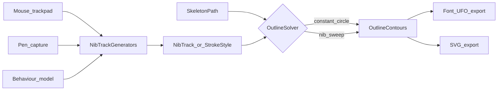

# Strokes, nib and pen input — living roadmap

**Branch:** `explore/strokes` only. Isolated from [UI sound](../README.md#tracks); do not link from [ROADMAP.md](../../ROADMAP.md) until Kostya aligns.

**Last revised:** 2026-11-20

## How to use this document

- This is the shared vision for strokes, nibs, and pen input. It is **not** canonical repo architecture; see [docs routing](../../docs/architecture/index.md).
- Work in **streams** (Foundation, A, B, C, D). Each task has a status, size guess, and **Learn** field: what we expect to discover.
- Stop at **checkpoints** to answer the review questions, update the **decision log**, and pivot or continue.
- When `main` ships unrelated contour work (e.g. remove overlap, offset path on the product roadmap), refresh dependencies in §Margins and re-check CP3.
- **Alignment:** data-model choices and any user-visible UI go to Kostya on Discord first; open an umbrella GitHub issue on `shift-editor/shift` after **CP1** passes.

### Task status key

| Status | Meaning |
| ------ | ------- |
| `—` | Not started |
| `spike` | Time-boxed experiment |
| `wip` | In progress |
| `done` | Exit criteria met on this branch or upstream |
| `pivot` | Stopped or redirected; see decision log |
| `blocked` | Waiting on dependency or alignment |

### Size key

`S` (< few days), `M` (about a week), `L` (multi-week), `XL` (epic; split at checkpoint).

---

## Vision

Shift should support **editable skeleton paths** whose **outlines are derived**: icon-style constant strokes first, then calligraphic nibs and stroke styles, with **mouse and pen interoperable** on the same nib track. Glyphs remain the default artifact; **SVG export is unconditional** for every glyph, with optional icon niceties on top.

**Reference product space:** LTTR/INK (skeleton type design, per-point nib, stroke styles, clean vectorisation), Figma-like stroke caps/joins/width on paths, Fontographer-style craft for type.

**Not in vision v1:** live collaboration on strokes, AI-generated nibs, a separate “icon app” mode, or shipping Fontographer sound/haptics here (see `explorations/ui-sound` when that branch is present).

### One pipeline

- **Skeleton:** ordinary contour geometry (points, segments, open/closed).
- **Nib track / stroke style:** caps, joins, width, miter; later width/height/angle per point and named styles.
- **Solvers:** exact offset for circular nib (kurbo `stroke` / `offset`); sampled sweep + union + refit for general nibs ([linesweeper](https://crates.io/crates/linesweeper) already used for booleans).
- **Generators (stream C):** all produce the same nib-track data; users can switch input method mid-glyph.

### Non-goals (for now)

- Replacing the Pen tool’s point-by-point model entirely.
- iOS-native pen capture inside Shift Desktop (Sidecar is in scope only via Electron pointer events).
- Competing with full parametric stroke interpolation (LTTR/INK “Master” tier) before B4/B5 prove the data model.

---

## Engineering invariants (from Shift)

- **Rust owns the solver and export semantics** ([shift-font](../../crates/shift-font/docs/DOCS.md), [shift-wasm route](../../crates/shift-wasm/docs/DOCS.md)): no second TypeScript implementation of outline generation; call WASM for editor-sync rules.
- **Types** live in `@shift/types` / domain patterns; no ad-hoc stroke structs in app files.
- **Tests:** behavior via `TestEditor` and Rust tests on fixtures; reference skeletons in `fixtures/` or `crates/shift-font/tests/`.
- **UFO round-trip:** prefer `com.shift.*` lib keys when the model is not representable in standard UFO contours alone (pattern used for grid: `com.shift.grid`).
- **Existing anchors:** kurbo 0.13 (`stroke`, `offset`, `simplify_bezpath`, `fit_to_bezpath`), [curve_fit.rs](../../crates/shift-font/src/curve_fit.rs), SVG **import** ([svg_path.rs](../../crates/shift-font/src/svg_path.rs)), boolean ops in [ir/boolean.rs](../../crates/shift-font/src/ir/boolean.rs).

### Relation to product [ROADMAP.md](../../ROADMAP.md)

| Product item | This exploration |
| ------------ | ---------------- |
| Offset path (Phase 3.5) | Stream A1; may upstream as product PR |
| Remove overlap | Dependency for A2/B6 mixing strokes and fills |
| SVG import | D1 is symmetric export |
| 0.5.0 Drawing Workflow Depth | A1–A3 are candidates once CP1 passes |

---

## Stream F — Foundation (P0)

**Goal:** Agree how strokes live in the font model, where solvers live, and how we judge outline quality—before UI diverges.

| ID | Task | Status | Size | Learn | Exit criteria |
| -- | ---- | ------ | ---- | ----- | --------------- |
| F0.1 | **Data model spike:** compare (a) stroke metadata on `Contour`, (b) parallel “skeleton” layer objects, (c) lib-only storage with generated outlines on export | `done` | M | UFO/persistence cost per option | [F0.1](./F0.1-data-model-spike.md) six validation rows + hybrid C→A |
| F0.2 | Define `StrokeStyle` + `NibSample` (minimal types): caps, joins, width, miter; nib width/height/angle optional | `wip` | S | Whether one struct covers A and B | Types sketched in spike doc or Rust stub |
| F0.3 | **Solver API:** `outline(skeleton, track, style) -> contours` in shift-font; two backends: `ExactOffset` vs `NibSweep` | `wip` | M | kurbo stroke quality on cubics with off-curve points | `ExactOffset` + 5 fixtures; `NibSweep` not started |
| F0.4 | **Quality bar + fixtures:** cubic-only output, points at extrema, no self-overlap, tangent continuity target; fixtures: simple icon stroke, roman stem, italic stem, blackletter stub | `wip` | M | Refit point count vs LTTR/INK “clean” bar | CP0 metrics in [F0.1](./F0.1-data-model-spike.md); extrema/overlap deferred |
| F0.5 | WASM exposure plan: which calls are per-edit vs export-only | `—` | S | Editor frame budget for sweep | Note in decision log |

**Phase exit (CP0):** F0.1 recommendation accepted; F0.4 metrics defined; Kostya pinged if model is (b) or lib-heavy. **Status (2026-11-20):** CP0 **met** on branch — hybrid **C→A** ratified; lib round-trip + orphan prune + `LayerMatch` + `ExactOffset` fixtures green; A1 still blocked on Kostya alignment gate until Discord summary.

---

## Stream R — Research and competitive intelligence

**Goal:** Know what “better than today” means before we lock solvers and UI. Research runs in **waves** (see [RESEARCH.md](RESEARCH.md)); it does **not** block F0.1 or A1 spikes unless CP2 quality fails.

| ID | Task | Status | Size | Learn | Exit criteria |
| -- | ---- | ------ | ---- | ----- | --------------- |
| R0 | **Wave 0 digest:** LTTR/INK, Glyphs strokes/offset, FontLab 8–9, forum pain points | `done` | M | Initial “must match” list | [RESEARCH.md](RESEARCH.md) wave 0 |
| R1 | **Theory wave:** Noordzij translation/expansion, rotation contrast, envelope/sweep papers | `—` | M | Constraints on B1 solver | §Theory in RESEARCH + decision log |
| R2 | **Product scan:** BroadNibber, Noodler, RoboFont plugins, Figma stroke parity checklist | `—` | M | Gaps vs Stream A | Feature matrix appendix |
| R3 | **Sentiment wave:** TypeDrawers, Glyphs forum, X/search for skeleton/stroke tooling | `—` | M | Quotes + pain themes | Sentiment appendix with URLs |
| R4 | **Differentiation brief:** one page “why Shift” vs LTTR + Glyphs + FontLab | `—` | S | What we will not copy | Linked from CP2 gate |

**Cadence:** refresh R at CP0 (scope), CP2 (outline quality), CP4 (pen UX). Exa/web search is enough for waves 1–3; no multi-week research phase before coding.

---

## Stream A — Path operations (icons)

**Goal:** Figma-class constant-width strokes on editable paths; substrate for B (width profile = degenerate nib).

| ID | Task | Status | Size | Learn | Exit criteria |
| -- | ---- | ------ | ---- | ----- | --------------- |
| A1.1 | Destructive **Outline stroke** command (open + closed paths, round/butt/square caps, miter/bevel/round joins) | `done` | M | kurbo vs font point types conversion | `OutlineStroke` intent + fixtures; undo via `FontChange` |
| A1.2 | Destructive **Offset path** (grow/shrink); ticks product “Offset path” when upstreamed | `done` | M | Offset failure on tight concave icon paths | `OffsetContour` intent (closed contours); grow/shrink test |
| A1.3 | Closed skeleton → ring (hole rules documented) | `—` | S | Winding vs remove-overlap policy | Test on donut icon |
| A2.1 | **Non-destructive stroke:** store style + skeleton; regenerate outline on edit | `—` | L | Invalidation graph in glyph model | Edit skeleton → outline updates; save/reopen |
| A2.2 | **Expand to outlines** (bake) for export/font constraints | `—` | S | When UFO stores skeleton vs outlines only | Export path documented |
| A3.1 | Stroke panel: width, caps, joins, miter limit | `—` | M | Base UI patterns for sidebars | Manual QA script |
| A3.2 | Canvas preview of generated outline (distinct from skeleton) | `—` | M | Render pass ownership | Visible skeleton + outline |
| A4.1 | Dashed strokes | `—` | M | SVG dash parity | Deferred until D2 |
| A4.2 | Width profile along path (scalar width per point) | `—` | M | Bridge to B2 without separate model | One profile = nib with fixed angle |
| A4.3 | Define **extrude** (if not plain offset): shadow/long extrusion vs thickness | `—` | spike | User expectation | Decision or park in parking lot |

**Depends on:** F0.*; product **Remove overlap** for A2 mixing with filled contours (or local union-only workaround flagged as tech debt).

**Phase exit (CP1):** A1.1 on branch with tests; quality bar from F0.4 met; go/no-go for A2.

---

## Stream B — Nib model (type and calligraphy)

**Goal:** LTTR/INK-class skeleton design: per-point nib, stroke styles, master interpolation.

| ID | Task | Status | Size | Learn | Exit criteria |
| -- | ---- | ------ | ---- | ----- | --------------- |
| B1.1 | Fixed-angle **ellipse nib** sweep along skeleton | `—` | L | Sample density vs quality | Fixture stems within quality bar |
| B1.2 | Fixed-angle **rectangle nib** (optional v1) | `—` | M | Corner artifact rate | Same or descoped |
| B2.1 | Nib track keyed at on-curve points; interpolate width/height/angle along segments | `—` | L | Rotation contrast stability | 3 LTTR-like test paths |
| B2.2 | **Rotation contrast** (angle follows tangent / user offset) | `—` | M | Noordzij expansion vs translation | Documented modes |
| B3.1 | Canvas nib handles (width, angle) | `—` | L | Hit target size | Edit nib → live outline |
| B3.2 | Nib panel (numeric + linked dimensions) | `—` | M | | |
| B4.1 | Named **stroke styles** (font-wide presets) | `—` | L | Update propagation scope | Change style → all linked nibs |
| B4.2 | Assign / detach / reset nib from style | `—` | M | | LTTR/INK parity checklist |
| B5.1 | Interpolate nib tracks across masters (variation-aware) | `—` | XL | Skeleton structure matching rules | Two-master test font |
| B6.1 | Mix stroked skeletons + plain outlines in one glyph | `—` | M | Layer ordering | CP3 test |
| B6.2 | Refit pass after sweep (point count, extrema) | `—` | L | Whether curve_fit + simplify is enough | Point count ceiling |

**Phase exit (CP2):** B1.1 quality gate; if fail → decision: better refit, coarser sampling, or limit nib shapes.

**Phase exit (CP3):** A2 and B2 use **one** nib-track representation (no parallel “icon stroke” type).

---

## Stream C — Input and behaviour

**Goal:** Desktop mouse/trackpad as default; pen and behaviour model write the **same** nib track, interoperably.

| ID | Task | Status | Size | Learn | Exit criteria |
| -- | ---- | ------ | ---- | ----- | --------------- |
| C1.1 | **Pointer audit** on macOS: pressure, tiltX/Y, twist, pointerType for trackpad, mouse, Wacom, Sidecar | `wip` | S | What Electron actually delivers | Compatibility matrix in [C1.1-pointer-audit.md](./C1.1-pointer-audit.md); **trackpad row in progress** (other hardware later) |
| C2.1 | Record raw stroke (position, pressure, tilt, time) during pen draw | `—` | M | Sampling rate vs contour point budget | Serialized sample in test |
| C2.2 | Map pressure → width; azimuth/tilt → angle (configurable curves) | `—` | M | Saturation at light pressure | |
| C3.1 | Fit capture → skeleton + nib keyframes (`curve_fit`, kurbo fit) | `—` | L | Editability after fit | User can move points; outline follows |
| C4.1 | **Interop rules:** replace vs merge track; mouse edit after pen capture | `—` | S | UX spec | Documented + one E2E scenario |
| C4.2 | Pen tool mode: “draw skeleton” vs “record stroke” | `—` | M | | |
| C5.1 | Behaviour model: posture params → angle/width from path direction (optional generator) | `—` | L | Value for mouse-only users | A/B vs manual nib on fixture |
| C5.2 | Generator plug-in boundary: `NibTrackGenerator` trait in Rust | `—` | M | | Pen and behaviour implement it |

**Phase exit (CP4):** C1.1 + C3.1 on real hardware; decide C5 depth (full model vs simple “follow tangent”).

---

## Stream D — SVG output

**Goal:** Every glyph exportable as SVG; icon workflows get extra options, not a separate app.

| ID | Task | Status | Size | Learn | Exit criteria |
| -- | ---- | ------ | ---- | ----- | --------------- |
| D1.1 | **Glyph → SVG path** export from shift-font (Y-up consistent with import) | `—` | M | Round-trip with import | Import(export(g)) ≈ g |
| D1.2 | Export command / API surface (CLI + editor) | `—` | M | | |
| D2.1 | Icon options: explicit viewBox, default metrics alignment | `—` | S | | |
| D2.2 | Stroke-preserving SVG when style is constant round stroke; else expanded paths | `—` | M | Figma SVG compatibility | Sample icon font glyph |
| D2.3 | Keyline / grid metadata in SVG (optional, ties to grid #930) | `—` | S | | |
| D3.1 | Icon-font batch export niceties (naming, folder layout) | `—` | M | | Deferred post D1 |

---

## Checkpoints

| CP | When | Questions | Pivot / stop if |
| -- | ---- | --------- | ---------------- |
| **CP0** | F0.1 + F0.4 done | Where does stroke data live? What is “good enough” outline? | Cannot round-trip UFO → park B until model fixed |
| **CP1** | A1 shipped on branch | Is destructive outline enough for icons? Proceed to A2? | Outline quality fails fixtures → fix F0.3 before UI |
| **CP2** | B1.1 prototypes | Are sweep outlines shippable? | Point count > 2× hand-drawn → refit spike or narrow nib |
| **CP3** | A2 + B2 both planned | One nib track type for icon + type? | Two types → redesign F0.2 before more UI |
| **CP4** | C hardware test | Is pen capture worth product UI? How much C5? | No pressure on hardware → prioritize C5.1 lightly |
| **Standing** | Monthly or after major `main` merge | Dependencies still accurate? Kostya priorities? | Update §Status summary |

---

## Status summary

| Stream | Phase focus | Next actionable |
| ------ | ----------- | ---------------- |
| R | Wave 0 done | R1 theory before CP2; R2–R3 parallel with F0 |
| F | CP0 met on branch | F0.2 types; F0.3 nib sweep; alignment ping |
| A | A1.1–A1.2 on branch | CP1 quality gate on fixtures |
| B | — | Blocked on CP0 |
| C | — | C1.1 can run in parallel (read-only audit) |
| D | — | D1.1 can spike in Rust in parallel with F0.3 |

---

## Margins

### Decision log

| Date | Decision | Alternatives | Rationale |
| ---- | -------- | ------------ | --------- |
| 2026-11-20 | Adopt single-pipeline, three-stream roadmap on `explore/strokes` | Jump straight to LTTR clone; icon-only offset tool | Substrate + continuity; SVG export unconditional |
| 2026-11-20 | Detailed tasks for all streams; refine at checkpoints | Detail only stream A | User asked for full vision with margins to pivot |
| 2026-11-20 | Stream R research waves; wave 0 digest in RESEARCH.md | Block all code on full Exa pass | Research parallel to F0, deepens at CP2/CP4 |
| 2026-11-20 | **Stroke data: hybrid C→A** (layer lib `com.shift.stroke` now; `ContourRole` after CP0) | Parallel skeleton layer (B); contour-only metadata day one (A) | UFO round-trip proven; low blast radius; promotes to A once lib/sync stable |
| 2026-11-20 | **CP0 exit** on `explore/strokes` | Ship A1 before validation | All F0.1 validation rows + F0.4 CP0 metrics documented; `ExactOffset` in shift-font |

### Open questions

| ID | Question | Retired by |
| -- | -------- | ---------- |
| Q1 | Is stroke data a first-class layer or contour annotation? | F0.1 |
| Q2 | Does non-destructive stroke store skeleton in UFO or only in `.shift`? | F0.1 + save/reopen test |
| Q3 | What does “extrude” mean for icons? | A4.3 |
| Q4 | Minimum point count / extrema policy vs LTTR/INK? | F0.4, B6.2 |
| Q5 | SVG export: one glyph per file vs sprite sheet default? | D1.2 |

### Assumptions

- Constant-width stroke can use exact offset without nib sweep.
- linesweeper union is sufficient to merge sweep tiles before refit.
- Variation interpolation can reuse master matching once skeleton topology is stable (B5).

### Risk register

| Risk | Impact | Mitigation |
| ---- | ------ | ---------- |
| Sweep outlines too heavy | B blocked | CP2 refit; limit to ellipse v1 |
| UFO spec has no stroke skeleton | Export loss | `com.shift.stroke` lib JSON + bake on UFO export |
| Electron omits pen tilt | C degraded | Behaviour model (C5); document matrix |
| Remove overlap late on product roadmap | A2/B6 messy overlaps | Document union-only interim; track [ROADMAP](../../ROADMAP.md) |
| Scope creep vs 0.5.0 | Delay | Upstream A1 only after CP1; keep exploration on branch |

### Spike budget (per phase)

| Phase | Time box | Outcome |
| ----- | -------- | ------- |
| F0 | 1 week | Decision log + 3 passing fixture tests for ExactOffset |
| B1 spike | 1 week | Visual + point-count report on 4 fixtures |
| C1 | 2 days | Pointer matrix filled |
| D1 spike | 3 days | Round-trip one glyph |

### Parking lot

- Stress heatmaps / curve quality overlays (separate from strokes).
- Haptic/sound on snap while drawing skeleton (separate track: `explore/ui-sound`, see [explorations index](../README.md)).
- Illustrator-width-tool compatible SVG import of variable width.
- Automatic script categorization (unrelated roadmap item).

---

## Alignment gates

1. **Before F0.1 recommendation is implemented in product types:** Discord summary + link to this file (fork-only branch).
2. **Before any renderer/UI for strokes:** CP0 passed + Kostya ack.
3. **Before PR to `shift-editor/shift`:** CP1 for stream A; umbrella issue describing B/C/D as follow-on.
4. **SVG export PR:** can be proposed independently after D1.1 round-trip if it does not entangle stroke model.

---

## Revision history

| Date | Author | Change |
| ---- | ------ | ------ |
| 2026-11-20 | teyepe / agent | Initial living roadmap from planning session |
| 2026-11-20 | teyepe / agent | Stream R + RESEARCH.md wave 0 competitive digest |